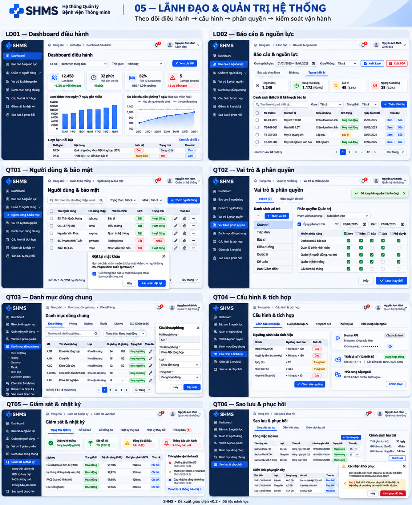
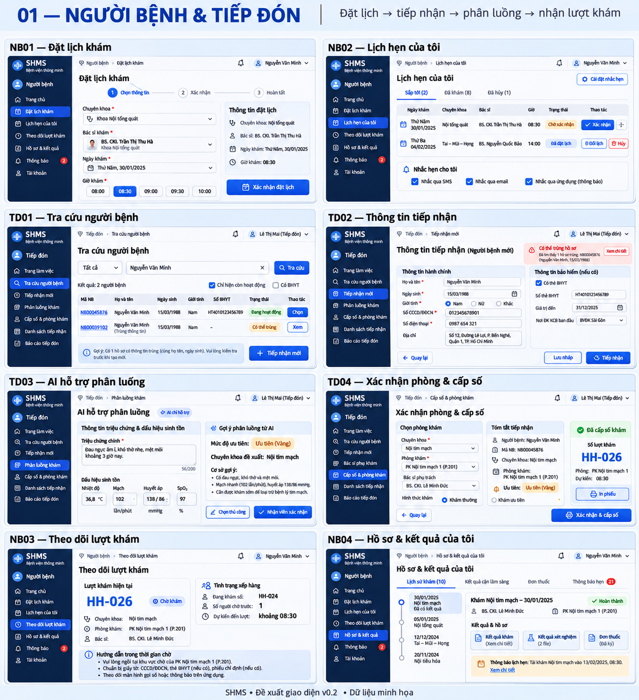

# Cẩm nang sử dụng SHMS

> **SHMS — Hệ thống Quản lý Bệnh viện Thông minh.** Tài liệu công khai này hướng dẫn từng vai trò sử dụng phần mềm: tiếp đón, bác sĩ, điều dưỡng, dược/viện phí, lãnh đạo và quản trị hệ thống.

## Bắt đầu nhanh

1. Mở hệ thống tại đường dẫn nội bộ **`/shms/`** và đăng nhập bằng tài khoản được cấp.
2. Nếu tài khoản bật **xác thực 2 lớp (2FA)**, nhập thêm mã 6 số từ ứng dụng xác thực.
3. Menu bên trái hiển thị đúng các chức năng theo **quyền** của bạn — vai trò khác nhau thấy menu khác nhau.

> **Mẹo:** Mỗi người chỉ thấy phần việc thuộc quyền mình. Nếu thiếu một mục, hãy liên hệ quản trị viên để được cấp quyền.

## Tài khoản demo

| Vai trò | Tài khoản | Mật khẩu |
|---|---|---|
| Quản trị viên | `admin` | `admin123` |
| Bác sĩ | `bacsi` | `bacsi123` |
| Tiếp đón | `tiepdon` | `tiepdon123` |
| Kế toán/Viện phí | `ketoan` | `ketoan123` |
| Dược sĩ | `duocsi` | `duocsi123` |
| Quản lý dự án (Hub) | `pm` | `pm123` |

## Hướng dẫn theo vai trò

- **[Tiếp đón & đăng ký khám](journey-tiep-don.md)** — tiếp nhận người bệnh, kiểm tra BHYT, cấp số khám.
- **[Bác sĩ khám chữa bệnh](journey-bac-si.md)** — hàng chờ, khám, chỉ định cận lâm sàng, kê đơn, bệnh án.
- **[Điều dưỡng & nội trú](journey-dieu-duong.md)** — sơ đồ giường, chăm sóc, theo dõi sinh hiệu IoT.
- **[Dược & viện phí](journey-duoc-vien-phi.md)** — cấp phát thuốc, tồn kho, bảng kê, thu tiền.
- **[Lãnh đạo & quản trị](journey-lanh-dao-quan-tri.md)** — dashboard, báo cáo, danh mục, phân quyền.
- **[Project Hub](journey-hub.md)** — quản lý tài liệu, task, truy vết, nghiệm thu.

## Tổng quan các nhóm màn hình

SHMS gồm **67 tính năng bệnh viện** chia theo nhóm quản trị (A) và nghiệp vụ (U), cùng **9 tính năng Project Hub**. Xem chi tiết tại [Danh mục tính năng](../02-yeu-cau/00-danh-muc-tinh-nang.md).

---

### Tài liệu kỹ thuật (dành cho đội phát triển)

Ngoài cẩm nang sử dụng, kho tài liệu còn có phần đặc tả cho đội dự án: [Danh mục nguồn](01-danh-muc-nguon.md), [Yêu cầu & đặc tả](../02-yeu-cau/00-danh-muc-tinh-nang.md), [Màn hình](../03-man-hinh/00-danh-muc-man-hinh.md), [Kiến trúc](../04-kien-truc/00-kien-truc-tong-the.md), [Dữ liệu](../05-du-lieu/00-mo-hinh-du-lieu.md), [API](../06-api/00-hop-dong-api.md), [Truy vết](../07-truy-vet/00-ma-tran-truy-vet.md), [Kế hoạch](../08-backlog/00-ke-hoach-trien-khai.md).
