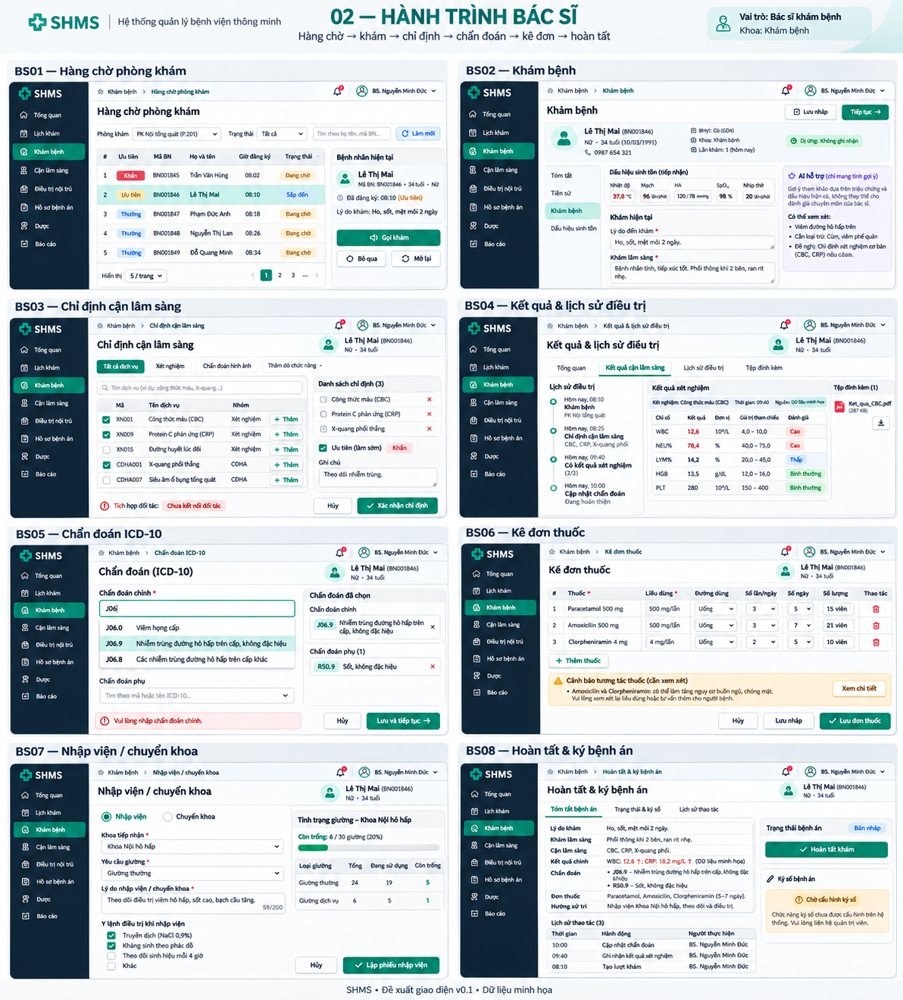

# Hướng dẫn: Bác sĩ khám chữa bệnh

> Dành cho **bác sĩ (BS)**. Mục tiêu: khám, chẩn đoán, chỉ định cận lâm sàng, kê đơn và hoàn thiện bệnh án theo đúng quy trình.

## Quy trình một lượt khám

1. **Mở hàng chờ** — vào *Tiếp đón & khám → Hàng chờ khám*, chọn người bệnh theo số thứ tự. Có thể lọc theo khoa.
2. **Khám & chẩn đoán** — mở lượt khám, ghi triệu chứng và chọn **chẩn đoán ICD-10** (chính/phụ).
3. **Chỉ định cận lâm sàng** — tạo chỉ định xét nghiệm/chẩn đoán hình ảnh. Kết quả trả về (mô phỏng LIS/RIS) hiển thị trong lượt khám và lịch sử.
4. **Kê đơn thuốc** — thêm thuốc, liều dùng, số lượng. Hệ thống **cảnh báo tương tác thuốc** (AI). Bấm **Ký đơn** để chốt.
5. **Bệnh án** — ghi tóm tắt diễn biến, hướng điều trị. Khi hoàn tất, **Ký bệnh án** để khóa (không sửa sau khi ký).
6. **In bệnh án** — bấm *In bệnh án* để in bản đầy đủ (hành chính, chẩn đoán, đơn thuốc, tóm tắt).
7. **Quyết định nhập/chuyển/xuất viện** — nếu cần nội trú, chuyển sang luồng nhập viện.

## Màn hình liên quan

| Việc cần làm | Menu |
|---|---|
| Chọn người bệnh để khám | Tiếp đón & khám → Hàng chờ khám |
| Khám, chỉ định, kê đơn | (mở từ lượt khám trong hàng chờ) |
| Xem bệnh án, ký, in | Tiếp đón & khám → Bệnh án |
| Xem lịch sử & kết quả CLS | Tiếp đón & khám → Lịch sử điều trị |

> **Quan trọng:** Bệnh án và đơn thuốc sau khi **ký** sẽ bị khóa để đảm bảo tính pháp lý. Kiểm tra kỹ trước khi ký.

## Hỗ trợ AI

- **Cảnh báo tương tác thuốc** hiện ngay khi kê đơn.
- **Phân luồng** và **cảnh báo sớm** dựa trên dữ liệu sinh hiệu giúp ưu tiên ca nặng.

[← Tiếp đón](journey-tiep-don.md) · [Điều dưỡng & nội trú →](journey-dieu-duong.md)
