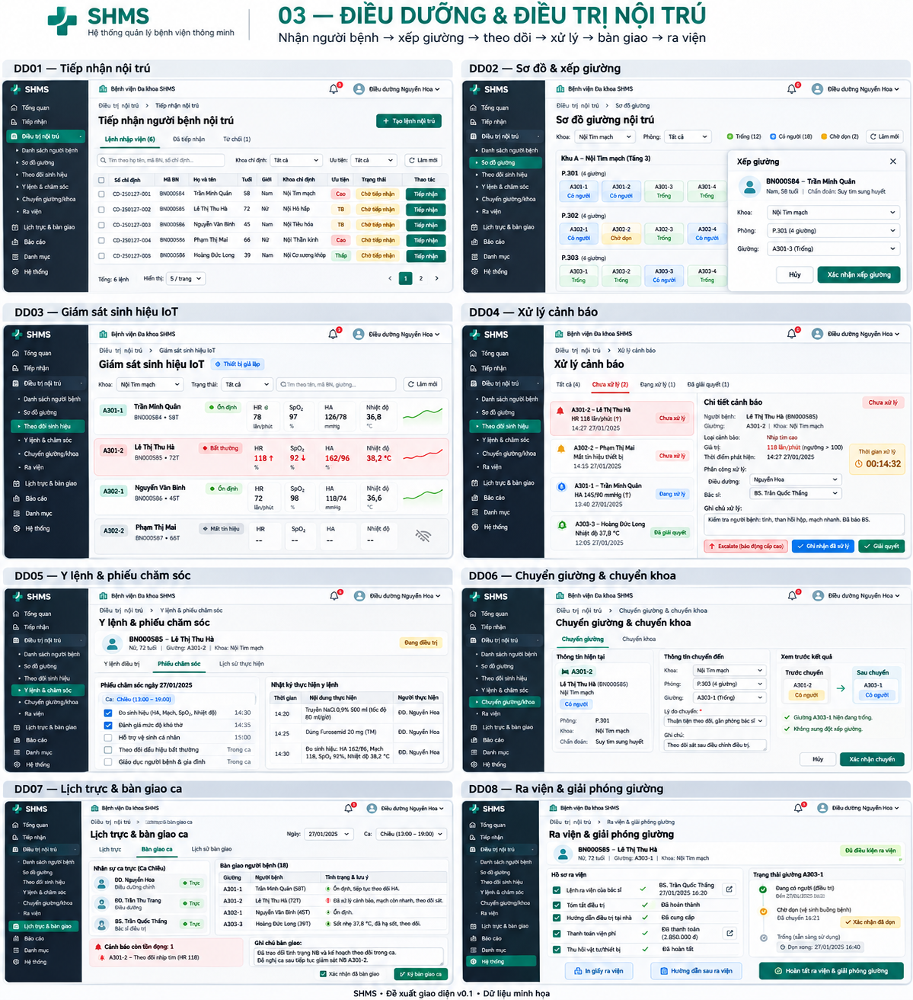

# Hướng dẫn: Điều dưỡng & nội trú

> Dành cho **điều dưỡng (DD)**. Mục tiêu: quản lý giường, thực hiện y lệnh, chăm sóc và theo dõi sinh hiệu người bệnh nội trú.

## Công việc hằng ngày

1. **Sơ đồ giường** — vào *Nội trú & nguồn lực → Sơ đồ giường* xem tình trạng giường theo khoa (trống/đã đặt/đang dùng/bảo trì).
2. **Danh sách nội trú** — xem người bệnh đang điều trị, phân theo giường/khoa.
3. **Thực hiện y lệnh & chăm sóc** — mở *Chăm sóc nội trú*, xem các **việc chăm sóc (care task)** và đánh dấu hoàn thành.
4. **Theo dõi sinh hiệu (IoT)** — vào *Theo dõi IoT* xem mạch, huyết áp, SpO₂, nhiệt độ theo giường và **xu hướng** theo thời gian.
5. **Xử lý cảnh báo** — khi sinh hiệu **vượt ngưỡng** hoặc **mất tín hiệu**, hệ thống sinh cảnh báo; kiểm tra và xử trí kịp thời.
6. **Thiết bị & lịch trực** — quản lý thiết bị y tế (lịch bảo trì) và lịch trực của khoa.

## Màn hình liên quan

| Việc cần làm | Menu |
|---|---|
| Xem/điều phối giường | Nội trú & nguồn lực → Sơ đồ giường |
| Thực hiện chăm sóc | Nội trú & nguồn lực → Chăm sóc nội trú |
| Theo dõi sinh hiệu | Nội trú & nguồn lực → Theo dõi IoT |
| Thiết bị, lịch trực | Nội trú & nguồn lực → Thiết bị & lịch trực |

> **An toàn người bệnh:** Cảnh báo mức *Khẩn cấp* (đỏ) cần xử trí ngay. Bấm **Quét cảnh báo lâm sàng** ở Trung tâm thông báo để tổng hợp các cảnh báo mới nhất.

## Mẹo nhanh

- Sinh hiệu trong bản demo được mô phỏng từ thiết bị IoT; luồng xử lý giống dữ liệu thật.
- "Mất tín hiệu" nghĩa là không có số liệu mới quá 30 phút — cần kiểm tra thiết bị tại giường.

[← Bác sĩ](journey-bac-si.md) · [Dược & viện phí →](journey-duoc-vien-phi.md)
