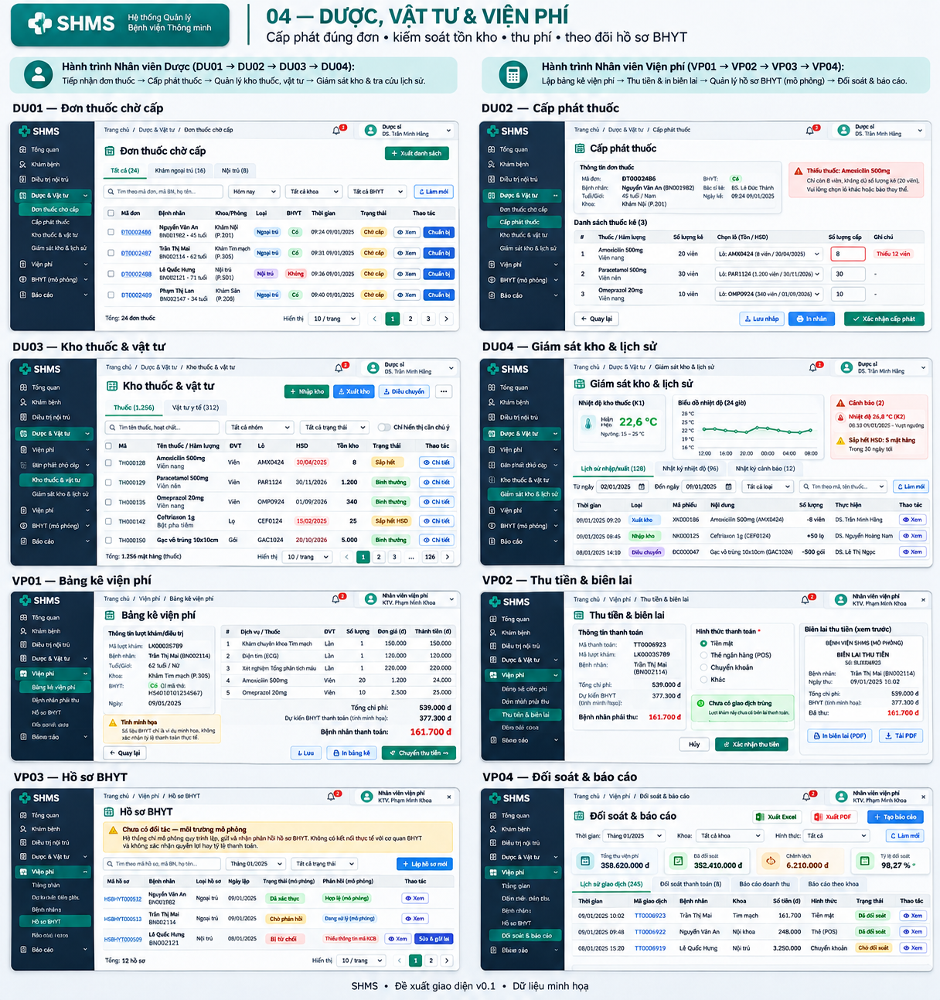

# Hướng dẫn: Dược & viện phí

> Dành cho **dược sĩ (DS)** và **kế toán/viện phí (KT)**. Mục tiêu: cấp phát thuốc đúng đơn, quản lý tồn kho/hạn dùng, lập bảng kê và thu tiền.

## Dược sĩ

1. **Cấp phát thuốc theo đơn** — vào *Dược & viện phí → Dược*, chọn đơn đã ký, cấp phát. Hệ thống trừ kho theo nguyên tắc **hết hạn trước xuất trước (FEFO)**.
2. **Tồn kho & hạn dùng** — theo dõi lô thuốc, số lượng, hạn dùng. Lô sắp hết hạn (dưới 90 ngày) được cảnh báo.
3. **Nhiệt độ kho thuốc (IoT)** — theo dõi nhiệt độ bảo quản (mô phỏng), cảnh báo khi vượt ngưỡng.

## Kế toán / viện phí

1. **Bảng kê & tách phần chi trả** — lập bảng kê cho lượt khám/đợt điều trị; hệ thống **tách phần BHYT và phần người bệnh tự trả**.
2. **Thu tiền & biên lai** — thu tiền, in biên lai (có số biên lai). Thao tác thu tiền an toàn với khóa chống trùng.
3. **Hồ sơ BHYT** — gửi/nhận phản hồi hồ sơ giám định (bản demo mô phỏng cổng BHYT).

## Màn hình liên quan

| Vai trò | Việc cần làm | Menu |
|---|---|---|
| DS | Cấp phát, tồn kho | Dược & viện phí → Dược |
| KT | Bảng kê, thu tiền, BHYT | Dược & viện phí → Viện phí |

> **Lưu ý tồn kho:** Cấp phát theo FEFO giúp giảm thất thoát do hết hạn. Kiểm tra cảnh báo hạn dùng định kỳ; bấm **Quét cảnh báo vận hành** ở Trung tâm thông báo để tổng hợp lô sắp hết hạn.

[← Điều dưỡng](journey-dieu-duong.md) · [Lãnh đạo & quản trị →](journey-lanh-dao-quan-tri.md)
