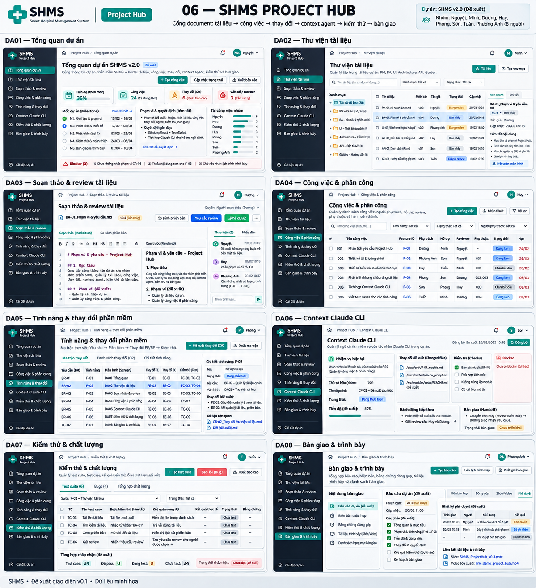

# Hướng dẫn: Project Hub

> Dành cho **quản lý dự án (PM), lập trình viên (DEV), kiểm thử (QA)**. Project Hub là không gian quản lý dự án SHMS: tài liệu, task, truy vết, nghiệm thu, quyết định.

## Các khu vực chính

1. **Tài liệu & review** — tạo tài liệu, thêm **version**, **so sánh** hai phiên bản, và **review** (duyệt / yêu cầu sửa).
2. **Task & phân công** — tạo task, gán người làm/người duyệt, chuyển trạng thái (DRAFT → … → DONE). Hệ thống **chặn tự duyệt** khi người làm trùng người duyệt.
3. **Ma trận truy vết** — xem liên kết task ↔ tính năng ↔ màn hình ↔ phụ thuộc, phục vụ kiểm soát độ phủ.
4. **Context & handoff** — ghi các mốc context/checkpoint/handoff để chuyển giao giữa các phiên làm việc.
5. **Test & nghiệm thu** — tạo test case theo tính năng, cập nhật kết quả (PASS/FAIL/NOT_RUN), đính kèm bằng chứng.
6. **Quyết định** — ghi lại quyết định dự án kèm thẩm quyền và lý do.

## Truy cập

Vào menu **Project Hub** (hiện khi tài khoản có quyền `hub.read`). Quyền chi tiết:

| Quyền | Làm được gì |
|---|---|
| `hub.read` | Xem mọi khu vực |
| `hub.write` | Tạo/sửa tài liệu, task, test case, quyết định, sự kiện |
| `hub.review` | Duyệt tài liệu, đóng vai người duyệt |

> **Nguyên tắc chất lượng:** Một task chỉ chuyển **DONE** khi người duyệt khác người làm. Mọi thay đổi tài liệu đi theo version để truy vết được.

[← Lãnh đạo & quản trị](journey-lanh-dao-quan-tri.md) · [Về mục lục](00-chi-muc.md)
