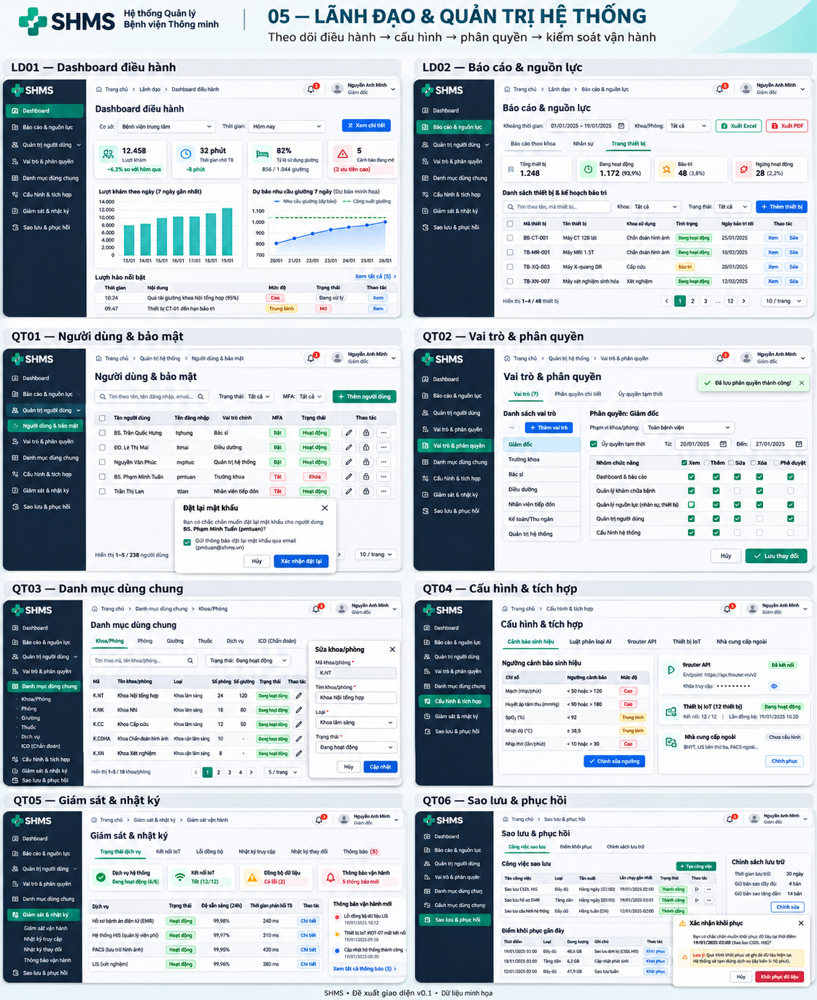

# Hướng dẫn: Lãnh đạo & quản trị hệ thống

> Dành cho **lãnh đạo (LD)** và **quản trị viên (QTV)**. Mục tiêu: theo dõi điều hành qua dashboard/báo cáo và quản trị danh mục, người dùng, phân quyền, cấu hình, giám sát.

## Lãnh đạo — điều hành & báo cáo

1. **Dashboard** — *Tổng quan* hiển thị chỉ số vận hành và widget **dự báo giường (AI)**.
2. **Báo cáo theo khoa/thời gian** — *Điều hành & báo cáo → Báo cáo*, lọc theo khoảng thời gian.
3. **Xuất dữ liệu** — xuất **CSV**, hoặc **In / Lưu PDF** bản báo cáo để trình bày.

## Quản trị viên — cấu hình hệ thống

| Việc cần làm | Menu | Ghi chú |
|---|---|---|
| Người dùng (thêm/khóa/đặt lại MK/xóa) | Quản trị → Người dùng | Ưu tiên **Khóa**; chỉ **Xóa** khi chưa phát sinh dữ liệu |
| Vai trò & phân quyền | Quản trị → Vai trò & nhập tài khoản | RBAC theo chức năng, phạm vi theo khoa, phân quyền tạm thời |
| Danh mục | Quản trị → Danh mục | Khoa/giường/dịch vụ/thuốc/ICD-10 |
| Cấu hình & ngưỡng | Quản trị → Cấu hình | Tham số vận hành, ngưỡng cảnh báo |
| Quy trình & sao lưu | Quản trị → Quy trình & sao lưu | Cấu hình quy trình, mẫu in, theo dõi sao lưu |
| Giám sát | Quản trị → Giám sát | Tình trạng hệ thống, nhật ký truy cập, tích hợp |

## Nguyên tắc Thêm / Sửa / Xóa danh mục

- **Thêm / Sửa**: mọi danh mục đều có.
- **Ngừng dùng (xóa mềm)**: giữ lại dữ liệu lịch sử — ưu tiên dùng cách này.
- **Xóa cứng**: chỉ thực hiện được khi bản ghi **chưa được tham chiếu** ở đâu (ví dụ thuốc chưa có đơn/tồn kho). Nếu đang dùng, hệ thống chặn và gợi ý dùng *Ngừng*.

> **Bảo mật:** Bật **2FA** cho tài khoản quản trị. Nhật ký truy cập/thao tác (audit) không sửa/xóa, phục vụ truy vết.

[← Dược & viện phí](journey-duoc-vien-phi.md) · [Project Hub →](journey-hub.md)
