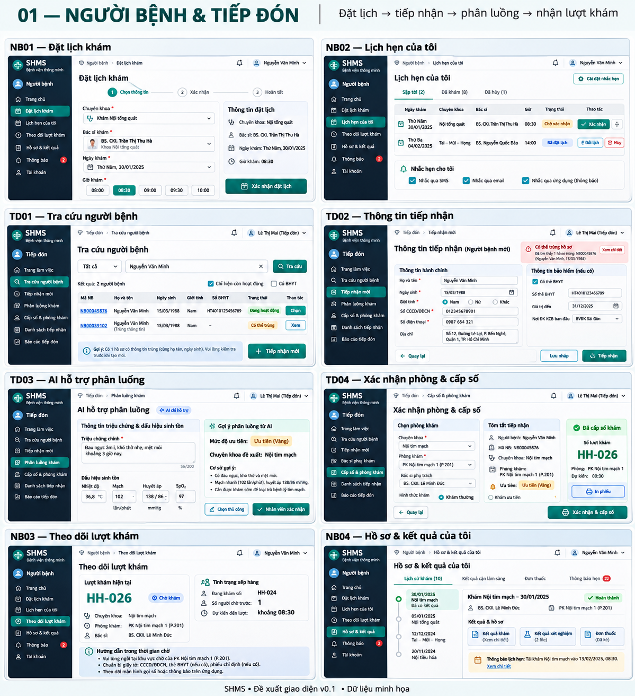

# Hướng dẫn: Tiếp đón & đăng ký khám

> Dành cho **nhân viên tiếp đón (TD)**. Mục tiêu: tiếp nhận người bệnh nhanh, đúng, cấp số khám và chuyển vào hàng chờ.

## Quy trình chuẩn

1. **Tra cứu người bệnh** — vào menu *Tiếp đón & khám → Người bệnh*, tìm theo tên/mã/CCCD/số thẻ BHYT. Nếu đã có hồ sơ, mở ra dùng lại.
2. **Tiếp nhận mới** — nếu chưa có, vào *Tiếp đón*, nhập thông tin hành chính (họ tên, ngày sinh, giới tính, địa chỉ, điện thoại). Hệ thống tự cấp mã người bệnh.
3. **Kiểm tra thẻ BHYT** — bấm *Kiểm tra BHYT* để xác thực thẻ (bản demo mô phỏng cổng giám định). Kết quả hiển thị mức hưởng và hạn thẻ.
4. **Đăng ký khám & cấp số** — chọn khoa/chuyên khoa, hệ thống cấp **số thứ tự** theo khoa trong ngày và đưa lượt khám vào hàng chờ.
5. **Đặt lịch trực tuyến** (nếu có) — tra cứu và xác nhận lịch hẹn người bệnh đã đặt online.

## Màn hình liên quan

| Việc cần làm | Menu |
|---|---|
| Tìm người bệnh | Tiếp đón & khám → Người bệnh |
| Tiếp nhận / cập nhật hành chính | Tiếp đón & khám → Tiếp đón |
| Cấp số, xem hàng chờ | Tiếp đón & khám → Hàng chờ khám |

> **Lưu ý:** Không tạo trùng hồ sơ. Luôn tra cứu trước khi tiếp nhận mới. Nếu người bệnh đã có mã, cập nhật thông tin thay vì tạo bản ghi mới.

## Mẹo nhanh

- Số thứ tự cấp **theo từng khoa** và reset mỗi ngày.
- Trường bắt buộc tối thiểu: họ tên. Các trường khác nên nhập đủ để phục vụ khám và viện phí.
- Thông báo nhắc lịch hẹn xuất hiện ở *Trung tâm thông báo* — bấm **Quét nhắc lịch** để sinh nhắc cho các hẹn trong 24h tới.

[← Về mục lục](00-chi-muc.md) · [Bác sĩ khám chữa bệnh →](journey-bac-si.md)
